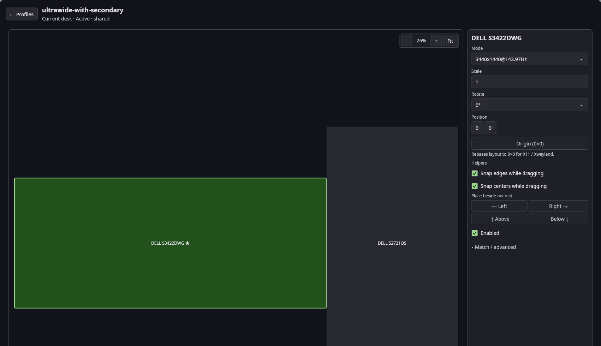
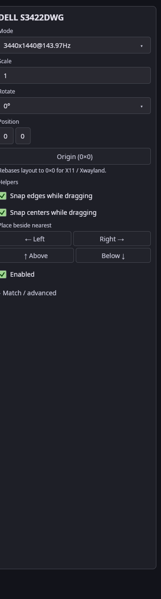
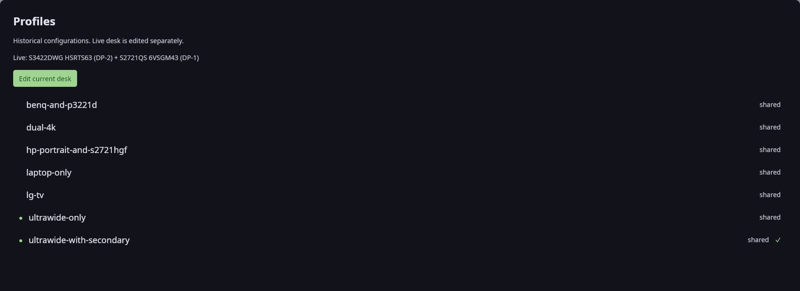

# dials

Desktop settings for Wayland sessions, in [Slint](https://slint.dev) on
[slint-kit](https://github.com/MasonRhodesDev/slint-kit). One window, six
sections:

- **Displays** — canvas-first editor for
  [`monitor-profiles`](https://github.com/MasonRhodesDev/monitor-profiles)
  TOML under `~/.config/hypr/profiles` (and shared `/etc/monitor-profiles`
  for the greeter). Save relies on
  [hyprstate](https://github.com/MasonRhodesDev/hyprstate)'s hot-reload —
  there is no separate Apply. Each monitor tile shows its wallpaper and the
  inspector sets it (see Wallpaper).
- **Power** — hyprstate's power policy map, sensors, and overrides.
- **Appearance** — [lmtt](https://github.com/MasonRhodesDev/linux-multi-theme-toggle)'s
  settings, rendered from lmtt's own config schema: dark/light mode, scheme
  type, palette source, GTK/icon/cursor/font and editor themes per mode,
  and the palette lmtt derived.
- **Help** — live graph of how hyprstate derives lid/power/display state.
- **More** — every other settings tool installed on the system, launched in
  its own window.







## Wallpaper

The display at the origin (logical 0,0) owns the global wallpaper: every
other display inherits it and lmtt derives the palette from it, so the two
never differ. Its inspector shows just the selector. Any other display
shows an "Override the global wallpaper" checkbox; ticked, Choose… gives
that display its own image, unticked removes it. Changes apply at once
(the appearance registry is separate from the profile Save writes). Images
are picked with the XDG portal file chooser.

Reads use the registry directly (`~/.config/appearance-profiles/default.toml`
over the system and packaged layers). Writes go only through `lmtt`:
`lmtt wallpaper set <image> [--output <display>]`, `lmtt wallpaper unset
--output <display>` (lmtt ≥ 0.3.2), then `lmtt switch <current mode>
--no-notify` so the palette, the published greeter/lock snapshot and every
lmtt module follow. Without `lmtt` on `PATH` the page still shows the
current wallpaper but cannot change it. Whether the desktop itself
repaints depends on the wallpaper daemon: on hypr-DE, swaybg reads the
registry when it starts, so it follows once hypr-DE restarts it from an
lmtt reload module; the lock screen and greeter (vigil) follow immediately.

## Appearance

The page draws the same schema `lmtt-config` renders in the terminal
(`~/.config/lmtt/config-schema.json`, refreshed by every `lmtt-config` run,
or a packaged `lmtt/config-schema.json` under the XDG data dirs). Option
lists come from lmtt-core's own detectors (installed GTK, icon and cursor
themes, fonts, VS Code and Neovim themes). Dark/Light switches at once
(`lmtt switch <mode>`); every other change waits for **Apply**, which
writes `~/.config/lmtt/config.toml` without touching your comments and
runs `lmtt switch` in the current mode so every module re-renders. The
wallpaper is shown here but set in Displays.

## Pages are optional modules

Each core-family integration is an in-process page module behind a cargo
feature (`src/pages`): `displays` (monitor-profiles, hyprctl), `power` and
`help` (hyprstate), `wallpaper` (lmtt and the appearance registry; plugs
into Displays through the hooks in `src/pages/mod.rs`), `appearance` (lmtt's
settings through lmtt-core and its config schema). A build without a
feature drops that page and its crates; a page whose tool is missing at
run time hides its toolbar button. `cargo build --no-default-features`
leaves only More. Third-party tools never become pages: More launches them
in their own window.

## Listing a tool under More

Dials does not embed other tools and has no plugin API. It reads XDG desktop
entries (`~/.local/share/applications`, then `$XDG_DATA_DIRS`) and lists an
entry when either holds:

- `Categories=` contains `Settings;` (the freedesktop convention — the same
  entry shows up in LXQt's and Xfce's settings managers), or
- `X-Dials-Section=<section>` is set. It also picks the section; without it
  the section (Appearance, Hardware, Network, System, Other) is derived
  from `DesktopSettings` / `HardwareSettings` / `Network` / `System`.

`NoDisplay`, `Hidden`, `OnlyShowIn` / `NotShowIn` (against
`$XDG_CURRENT_DESKTOP`) and a missing `TryExec` all hide an entry. `Exec`
field codes are dropped; tools are launched in their own process group.
`Terminal=true` entries run under `xdg-terminal-exec`, else `$TERMINAL`,
else the first of kitty / foot / alacritty / wezterm / ghostty on `PATH`;
with none of those they are hidden. `dials --entries` prints what More would list.

```ini
[Desktop Entry]
Type=Application
Name=Themes
Exec=kitty lmtt-config
Categories=Settings;DesktopSettings;
X-Dials-Section=Appearance
```

## Run

```sh
cargo run --release
```

Displays and Power need `hyprctl` on `PATH` (Hyprland session) and
hyprstate for apply; the Wallpaper field needs `lmtt`; More works on any
Wayland compositor. Packaged
Fedora/Arch installs put the binary in `/usr/bin` and a Settings desktop
entry in `/usr/share/applications`.

## Releasing

Bump `Cargo.toml`, `packaging/dials.spec` (+ `%changelog`), and
`packaging/PKGBUILD` together, then tag `vX.Y.Z`. CI builds the Arch package,
submits COPR, and dispatches [arch-repo](https://github.com/MasonRhodesDev/arch-repo).
